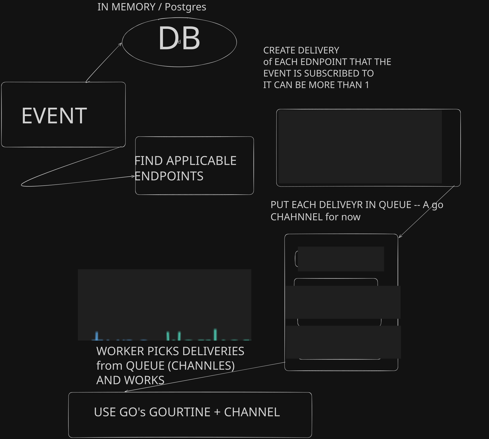
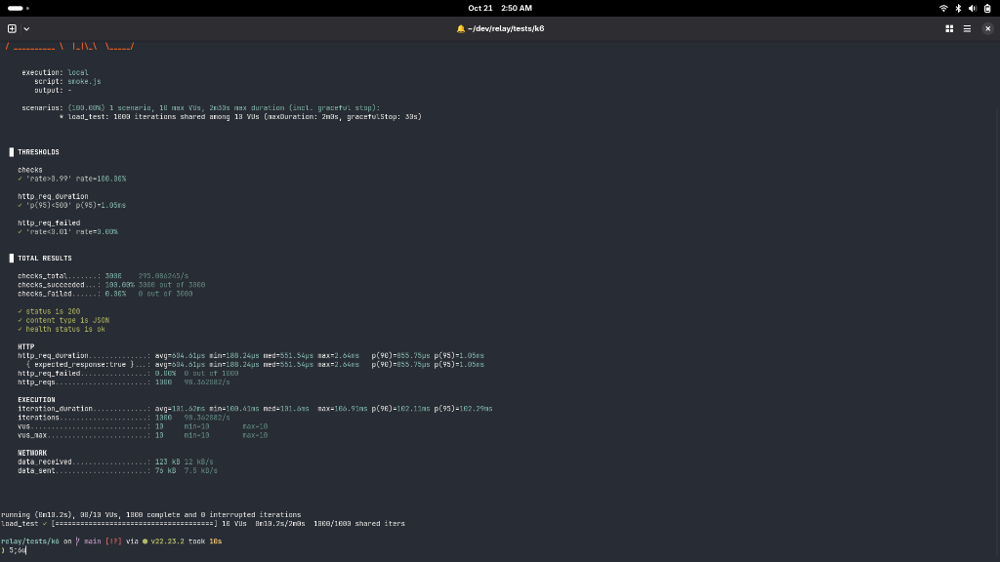
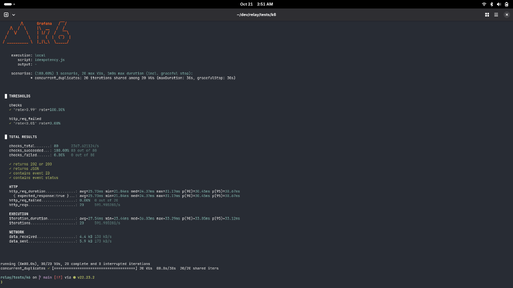

# Relay

**Developer Infrastructure for High-Reliability Webhook Delivery**  
*Publish events once. Deliver everywhere with at-least-once guarantees.*

[](https://golang.org)
[](https://www.postgresql.org/)
[](https://k6.io/)
[](https://opensource.org/licenses/MIT)

---

## Overview

Relay is a high-throughput, fault-tolerant webhook delivery and dispatch engine written in Go. 

Directly dispatching webhooks from application code introduces critical reliability hazards: downstream destinations experience outages, slow responses exhaust web server worker threads, network timeouts cause duplicate processing, and retries create thundering herd storms. 

Relay abstracts webhook delivery into resilient infrastructure:
* **Decoupled Ingestion:** Ingests events synchronously (`POST /v1/events`), guarantees persistence, and returns `202 Accepted` in sub-10ms.
* **Asynchronous Fan-Out:** Matches events to subscribed endpoints and dispatches payloads across a pool of concurrent worker goroutines.
* **Deterministic Retries:** Recovers transient errors (network drops, `429 Rate Limits`, `5xx Server Errors`) using exponential backoff with full jitter.
* **End-to-End Security:** Signs each delivery with `HMAC-SHA256` and a UNIX timestamp to protect consumers from payload tampering and replay attacks.
* **Auditability & Replay:** Maintains an append-only audit trail of every delivery attempt and enables manual or automated replay of dead-lettered events.

---

## Architecture

<p align="center">
  
</p>

### Execution Lifecycle

```text
 Client Application
         │
         │  POST /v1/events (with Idempotency-Key)
         ▼
 ┌─────────────────────────────────────────────────────────────┐
 │ Relay HTTP Engine                                           │
 │                                                             │
 │  1. Parse & Validate Payload                                │
 │  2. Check Idempotency (PostgreSQL UNIQUE index)             │
 │  3. Persist Event State (status: "queued")                  │
 │  4. Resolve Subscribed Endpoints (topic filtering)          │
 │  5. Dispatch Delivery Tasks to In-Memory Channel Buffer     │
 └──────────────────────────────┬──────────────────────────────┘
                                │ Non-blocking dispatch
                                ▼
 ┌─────────────────────────────────────────────────────────────┐
 │ Worker Engine (Concurrent Goroutine Pool)                   │
 │                                                             │
 │  1. Dequeue Delivery Task                                   │
 │  2. Generate HMAC-SHA256 Signature (X-Relay-Signature)      │
 │  3. Execute HTTP POST with Hard 10s Timeout                 │
 └──────────────────────────────┬──────────────────────────────┘
                                │
             ┌──────────────────┴──────────────────┐
             ▼                                     ▼
      HTTP 2xx (Success)               HTTP 429 / 5xx / Timeout
             │                                     │
     status: "delivered"               Calculate Exponential Backoff
             │                                 + Full Jitter
             ▼                                     │
    Record Audit Attempt                 Max Attempts Exceeded?
                                         ├── No  ─► Re-enqueue Task
                                         └── Yes ─► status: "failed" (DLQ)
```

---

## Core Engineering Guarantees

### 1. Concurrency-Safe Idempotency
Relay eliminates duplicate event processing through database-backed deduplication. When clients provide an `Idempotency-Key` header:
* An indexed compound constraint `UNIQUE(tenant_id, idempotency_key)` guarantees that identical event submissions cannot create redundant database records.
* In the event of network retries from the client, Relay catches constraint violations, loads the existing event record, and responds with the original resource without dispatching duplicate delivery jobs.

### 2. At-Least-Once Delivery & Failure Recovery
Webhook destinations inevitably fail. Relay handles delivery failures using an exponential backoff schedule with full jitter:

`Backoff(attempt) = Base(attempt) + UniformRandom(0, 1s)`

`Base(1) = 5s`, `Base(2) = 30s`, `Base(3) = 5m`, `Base(>= 4) = 30m`

* **Transient Failures (Retried):** Network timeouts, socket disconnections, `408 Request Timeout`, `429 Too Many Requests`, and `500-504 Server Errors`.
* **Permanent Failures (Failed Immediately):** `400 Bad Request`, `401 Unauthorized`, `404 Not Found`, and invalid target URLs. No retry resources are wasted on unrecoverable requests.
* **Dead Letter Queue (DLQ):** Deliveries that exhaust retry thresholds enter a permanent `failed` state, preserved for inspection and replay.

### 3. Cryptographic Signature Verification
Every webhook delivery includes an authenticity signature to ensure consumers can verify that payloads originated from Relay and were not tampered with in transit:

```http
POST /webhook HTTP/1.1
Host: consumer.example.com
Content-Type: application/json
X-Relay-Event-Id: evt_0192e472-8bfb-7892-9382-749e7bdac021
X-Relay-Timestamp: 1792435200
X-Relay-Signature: v1=5d41402abc4b2a76b9719d911017c592a2a0a256a73c1c469f68853b0709b1f2
```

The signature is computed as:

`Signature = HMAC-SHA256(endpoint_secret, timestamp + "." + payload)`

### 4. Zero-Hang Worker Isolation
Slow or unresponsive destination endpoints cannot starve Relay’s internal workers. All HTTP clients use a hardened 10-second request timeout (`Timeout: 10 * time.Second`). Once exceeded, the connection is forcibly terminated, recorded as a failed attempt, and queued for retry.

---

## Testing & Benchmarks

### 1. Cryptographic & Unit Tests
Relay includes unit tests verifying constant-time signature verification, payload tamper rejection, and timestamp validation:

```bash
# Execute all package unit tests
go test ./... -v
```

### 2. Performance & Load Benchmarks (k6)

Relay includes automated [k6](https://k6.io/) load testing scenarios under `tests/k6/` designed to validate system stability under concurrent stress:

| Test Scenario | Profile | Primary Threshold | Result |
| :--- | :--- | :--- | :--- |
| **Smoke Test (`smoke.js`)** | 1,000 iterations @ 10 VUs | Error rate `< 1%`, p95 `< 500ms` | **Passed** (`p95 = 1.05ms`, 0 errors) |
| **Ingestion Benchmark (`ingest.js`)** | Sustained event traffic | Ingest latency `p95 < 500ms` | **Passed** (`p95 = 1.74ms`, 0 errors) |
| **Concurrent Idempotency (`idempotency.js`)** | 20 parallel duplicate requests | 100% deduplication, 0 duplicates | **Passed** (1 record created, 0 race errors) |

To execute the test suite against a running instance:
```bash
# Baseline sanity check
k6 run tests/k6/smoke.js

# Ingestion latency under continuous traffic
k6 run tests/k6/ingest.js

# Race-condition validation on identical idempotency keys
k6 run tests/k6/idempotency.js
```

#### Benchmark Artifacts

**Baseline Smoke Test (1,000 iterations @ 10 VUs)**
* Validates service health, database pool connection stability, and baseline response latencies.
* Result: `p95 = 1.05ms`, `0.00%` failure rate across 1,000 requests.

<p align="center">
  
</p>

**Concurrent Idempotency Race Test (20 parallel duplicate requests)**
* Validates that simultaneous requests with identical `Idempotency-Key` headers are strictly deduplicated by PostgreSQL without race conditions or duplicate deliveries.
* Result: `100%` checks passed, `0` errors, single persistent record.

<p align="center">
  
</p>

---

## API Specification

### Endpoints

#### Register Endpoint
Registers a new consumer endpoint subscription.

```bash
POST /v1/endpoints
Content-Type: application/json
```
```json
{
  "url": "https://api.example.com/webhooks",
  "event_types": ["order.created", "invoice.paid"]
}
```

**Response (`201 Created`):**
```json
{
  "id": "ep_0192e471-70bf-7128-b2ef-3ad40a1fb8e0",
  "url": "https://api.example.com/webhooks",
  "event_types": ["order.created", "invoice.paid"],
  "secret": "whsec_0192e471-70bf-75a0-9706-e63d893ad7a2",
  "status": "active",
  "created_at": "2026-10-20T14:30:00Z"
}
```

---

#### List Endpoints
Lists all registered webhook endpoints.

```bash
GET /v1/endpoints
```

---

### Events

#### Ingest Event
Ingests a webhook event for asynchronous delivery.

```bash
POST /v1/events
Content-Type: application/json
Idempotency-Key: req_order_9981
```
```json
{
  "type": "order.created",
  "data": {
    "order_id": "ord_1024",
    "amount": 25000,
    "currency": "INR"
  }
}
```

**Response (`202 Accepted`):**
```json
{
  "id": "evt_0192e472-8bfb-7892-9382-749e7bdac021",
  "message": "Event accepted for async processing",
  "status": "queued"
}
```

---

#### Retrieve Event
Retrieves the current persistence state of an event.

```bash
GET /v1/events/{id}
```

---

#### Replay Events
Forces re-dispatch of historical or dead-lettered events without mutating past audit records.

```bash
POST /v1/events/replay
Content-Type: application/json
```
```json
{
  "event_ids": ["evt_0192e472-8bfb-7892-9382-749e7bdac021"]
}
```

**Response (`200 OK`):**
```json
{
  "status": "success",
  "message": "Events replayed successfully"
}
```

---

## Consumer Signature Verification

Downstream webhook consumers can verify deliveries using standard crypto primitives:

### Go
```go
package main

import (
	"crypto/hmac"
	"crypto/sha256"
	"encoding/hex"
	"fmt"
)

func VerifyRelayWebhook(payload []byte, signature, timestamp, secret string) bool {
	mac := hmac.New(sha256.New, []byte(secret))
	mac.Write([]byte(fmt.Sprintf("%s.%s", timestamp, string(payload))))
	expected := "v1=" + hex.EncodeToString(mac.Sum(nil))

	return hmac.Equal([]byte(signature), []byte(expected))
}
```

### Node.js
```javascript
const crypto = require("crypto");

function verifyRelayWebhook(payload, signature, timestamp, secret) {
  const hmac = crypto.createHmac("sha256", secret);
  hmac.update(`${timestamp}.${payload}`);
  const expected = `v1=${hmac.digest("hex")}`;

  return crypto.timingSafeEqual(Buffer.from(signature), Buffer.from(expected));
}
```

---

## Getting Started

### Prerequisites
* [Go 1.22+](https://go.dev/dl/)
* [Docker & Docker Compose](https://docs.docker.com/compose/)

### 1. Start Infrastructure
Start the PostgreSQL container (includes automatic schema initialization):
```bash
docker compose up -d
```

### 2. Start Relay
Run the HTTP API server:
```bash
go run cmd/api/main.go
```

The service binds to `http://localhost:3000`.

### 3. Health Check
```bash
curl -i http://localhost:3000/health
```

---

## Repository Structure

```text
relay/
├── cmd/
│   └── api/
│       └── main.go                 # Application entrypoint & dependency injection
├── internal/
│   ├── api/
│   │   └── handlers.go             # HTTP handlers & route definitions
│   ├── id/
│   │   └── id.go                   # Time-ordered UUIDv7 generator (evt_, ep_, whsec_)
│   ├── models/
│   │   ├── delivery.go             # Delivery and attempt state machine models
│   │   ├── endpoint.go             # Webhook subscriber and topic models
│   │   └── event.go                # Ingested event data models
│   ├── signature/
│   │   ├── signature.go            # HMAC-SHA256 signer & constant-time verifier
│   │   └── signature_test.go       # Timing-attack & tamper unit test suite
│   ├── store/
│   │   ├── memory.go               # Concurrent in-memory storage engine
│   │   ├── postgres.go             # Production PostgreSQL persistence (pgxpool)
│   │   └── store.go                # Storage interface abstraction
│   └── worker/
│       ├── retry.go                # Exponential backoff + jitter calculation
│       └── worker.go               # Concurrent worker pool and HTTP dispatcher
├── migrations/
│   └── 001_init.sql                # Relational schema (tables, constraints, indexes)
├── tests/
│   └── k6/                         # Load and concurrency test suites
│       ├── idempotency.js          # Race-condition idempotency test
│       ├── ingest.js               # Sustained ingestion throughput test
│       └── smoke.js                # Baseline service health check
├── docker-compose.yml              # Local container environment
├── go.mod
├── go.sum
└── README.md
```

---

## Engineering Roadmap

- [x] **Phase 1: Ingestion & Core Worker Pool**
  - Non-blocking HTTP ingestion API (`202 Accepted`)
  - Concurrency worker pool with bounded channel queue
  - Time-ordered UUIDv7 identifiers (`evt_`, `ep_`, `del_`)
  - Cryptographic webhook signing (`HMAC-SHA256`)
  - Exponential backoff with full jitter and transient status filtering
  - Dead Letter Queue & replay endpoint (`POST /v1/events/replay`)
- [x] **Phase 2: PostgreSQL Persistence & Audit Logs**
  - Connection pooling with `pgxpool`
  - Automated relational migrations (`001_init.sql`)
  - Durable persistence for events, endpoints, deliveries, and attempt audit logs
  - Race-condition proof idempotency via `(tenant_id, idempotency_key)` uniqueness
  - Timing-attack-resistant cryptographic verification (`hmac.Equal`) and unit test suite
- [x] **Phase 3: Redis Distributed Queue**
  - Decoupled HTTP API producer from background workers via Redis (`LPush` / `BRPop`)
  - Process crash resilience: queued tasks persist across server restarts and deployments
  - Horizontal scalability: multiple worker instances pull from shared queue
- [x] **Phase 4: Per-Destination Concurrency & Rate Limiting**
  - Token Bucket rate limiter (`golang.org/x/time/rate`) per destination endpoint
  - High-concurrency double-checked locking registry (`EndpointLimiter`)
  - Destination protection: eliminates thundering herds and 429 storms against slow clients
  - Unit test suite validating burst capacity, refill rates, and tenant isolation
- [ ] **Phase 5: Observability**
  - Prometheus metrics instrumentation (RPS, delivery latency, retry count)
  - OpenTelemetry distributed tracing

---

## License

This project is licensed under the MIT License — see the [LICENSE](LICENSE) file for details.
